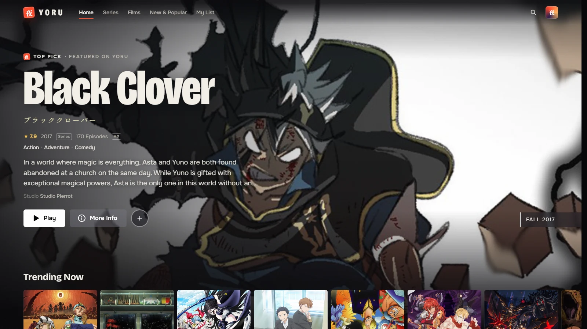
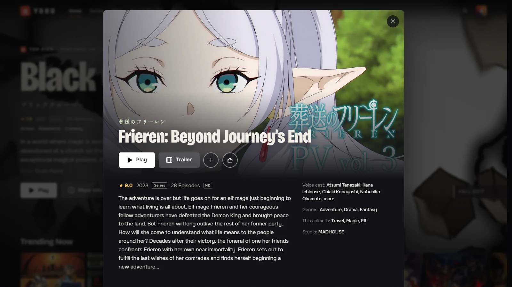
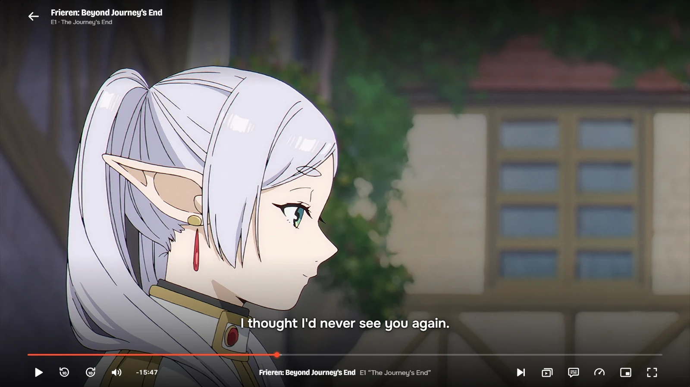
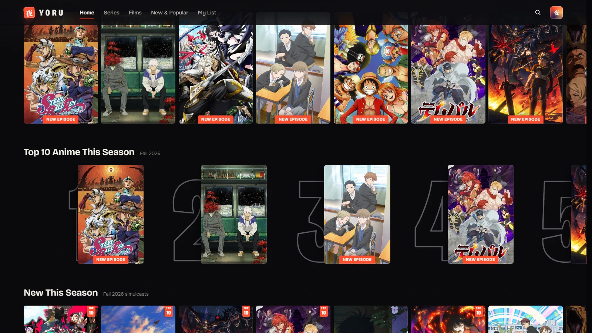
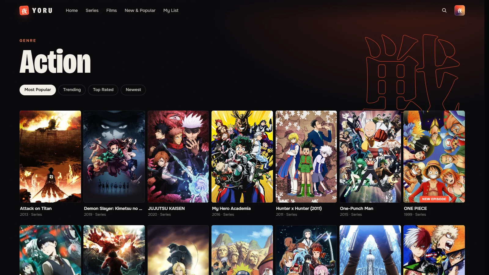
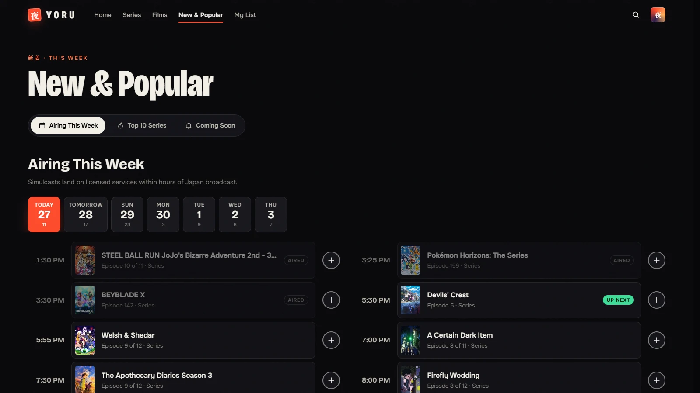
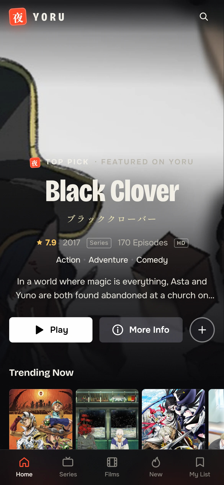
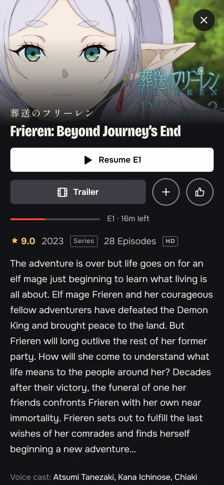
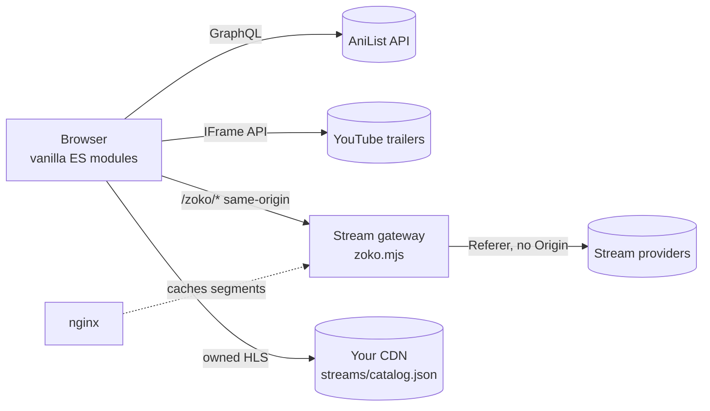

<div align="center">


# YORU 夜

**Anime, after dark.** A premium, Netflix-style home for anime: a live catalogue, a full adaptive-streaming player,
Continue Watching, ratings, and an on-device recommender that learns your taste.

[**Live demo →**](https://yoru.clawtrial.app)

[](https://yoru.clawtrial.app)
[](LICENSE)




</div>

---

## Contents

- [Screenshots](#screenshots)
- [Features](#features)
- [Quick start](#quick-start)
- [How it works](#how-it-works)
- [Configuration](#configuration)
- [Deployment](#deployment)
- [Project structure](#project-structure)
- [Contributing](#contributing)
- [Disclaimer](#disclaimer)
- [License](#license)

## Screenshots

| Title details | Player |
|---|---|
|  |  |
| **Rows & Top 10** | **Genres** |
|  |  |
| **New & Popular** | **Mobile** |
|  | <p align="center"> </p> |

## Features

| | |
|---|---|
| **Billboard** | A trending (or pinned) title with an autoplaying muted trailer. The synopsis tucks away once the trailer plays, and it pauses when scrolled out of view or covered by a modal. |
| **Rows** | Trending, the season's Top 10 with big numerals, simulcasts, favourites, acclaimed titles, films and next season. Genre rows and a personalised "Because you saved…" row lazy-load as you scroll. |
| **Hover preview** | Desktop only. A card expands, then plays its trailer after a beat, with Play, My List and More Info. |
| **Title details** | Ambient trailer header, episode list with titles and thumbnails, related seasons, More Like This, characters and voice cast, and where to watch officially. |
| **Player** | HLS adaptive streaming via hls.js; quality, audio and subtitle tracks; seek-preview thumbnails; Skip Intro & Recap; next-episode countdown; next-season hand-off; episode browser; resume; "Are you still watching?"; picture-in-picture; Media Session; full keyboard control and double-tap seeking on touch. |
| **YORU Clarity** | An optional WebGL2 output stage that renders each decoded frame at the display's real resolution with bicubic reconstruction, adaptive sharpening and deband dithering. |
| **Continue Watching** | Per-episode progress, landscape resume cards, progress bars everywhere, and a Viewing Activity page with a taste profile. |
| **Recommendations** | Top Picks, "Because you watched…", Continue the Story, match %, a personalised billboard and taste-ordered genre rows, all computed in the browser. |
| **New & Popular** | A day-by-day simulcast schedule for the week, Top 10 series and Coming Soon. |
| **Search, Genres, My List** | Live search (press <kbd>/</kbd>), infinite-scroll genre pages with sorting, and a list saved in the browser. |
| **Mobile** | Bottom tab bar, centred billboard and a full-screen title sheet. |

<details>
<summary><b>Player keyboard shortcuts</b></summary>

| Key | Action |
|---|---|
| <kbd>Space</kbd> / <kbd>K</kbd> | Play / pause |
| <kbd>J</kbd> <kbd>L</kbd> / <kbd>←</kbd> <kbd>→</kbd> | Seek back / forward |
| <kbd>↑</kbd> <kbd>↓</kbd> | Volume |
| <kbd>M</kbd> | Mute |
| <kbd>F</kbd> | Fullscreen |
| <kbd>C</kbd> | Subtitles |
| <kbd>S</kbd> | Skip intro / recap |
| <kbd>N</kbd> | Next episode |
| <kbd>P</kbd> | Picture-in-picture |
| <kbd>&lt;</kbd> <kbd>&gt;</kbd> | Playback speed |
| <kbd>0</kbd>–<kbd>9</kbd> | Jump to 0–90% |

</details>

## Quick start

**Requirements:** Node.js 18 or newer. There is nothing to install: no `node_modules`, no bundler, no framework.

```bash
git clone https://github.com/Assassin-1234/Yoru.git
cd Yoru
npm start
```

Open <http://localhost:5173>. Use the server rather than opening `index.html` directly, because YouTube embeds
refuse to play from `file://`.

| Script | What it does |
|---|---|
| `npm start` | Static site plus the `/zoko` stream gateway on `:5173` |
| `npm run start:streams` | The stream gateway alone on `:5174` (production layout) |
| `npm run build` | Writes a content-hashed production build to `dist/` |
| `npm run deploy` | Builds and ships to your server (see [Deployment](#deployment)) |
| `npm run sync:zoko` | Rebuilds the stream availability index in `streams/zoko.json` |

## How it works



### Front end

Plain HTML, CSS and ES modules with hash routing (`#/series`, `#/genre/Action`, `#/watch/<id>?ep=<n>`; an open
title is `?t=<id>` on top of any page). All metadata comes from the free, keyless
[AniList GraphQL API](https://anilist.co). Every page is one batched, aliased query cached in `localStorage` for
30 minutes, which keeps the app well under AniList's ~30 requests/minute limit. Episode titles are filled in from
[Kitsu](https://kitsu.io) where AniList's are missing or wrong.

### Player

`js/watch.js` loads [hls.js](https://github.com/video-dev/hls.js) on demand (with a subresource-integrity hash),
starts on a rung picked from measured throughput, and pre-fetches the first segments at the resume position
(`js/prefetch.js`). Nothing is transcoded or re-encoded on the server; the player receives each source's native
ladder.

### Stream resolution

`js/sources.js` decides what can play for a title, in this order:

1. **Owned streams** listed in `streams/catalog.json` (your own HLS, with intro/recap/credits markers).
2. **The stream gateway** (`zoko.mjs`, `anizone.mjs`, `stream-urls.mjs`), which resolves a title at play time and
   proxies its playlists, subtitles and segments through the same origin. Providers require a specific `Referer`
   and reject a browser `Origin`, which a custom player cannot control, so the gateway sends the headers each one
   expects. Hosts it will fetch are allow-listed in `stream-urls.mjs`.

See the [Disclaimer](#disclaimer) before running the gateway against any third-party source.

### Recommendations

Everything runs in the browser (`js/recs.js`); the viewing profile never leaves the device.

1. **Feedback → affinity.** Ratings, watch depth and completion, abandonment, My List and weak implicit signals
   (opening details, watching previews and trailers) become a signed, time-decayed score per title.
2. **Candidates.** Personalised PageRank (random walk with restart) over AniList's community recommendation graph,
   expanded two hops from your titles, plus content candidates from your strongest genres and tags.
3. **Scoring.** RP3β graph relevance (walk probability ÷ popularity^β, which matched or beat most neural
   recommenders in [Ferrari Dacrema et al., RecSys 2019](https://arxiv.org/abs/1907.06902)) plus cosine similarity
   between TF-IDF item embeddings and a Rocchio taste vector, minus a walk from disliked titles, with
   Bayesian-smoothed quality and Thompson-sampling exploration over genres.
4. **Re-ranking.** Franchise collapse (recommend the entry point, not season 4), Maximal Marginal Relevance for
   diversity, human-readable explanations and a calibrated match %.

AniList caps query complexity at 500, so the graph is walked with id-only queries and candidates are hydrated in
pages of 50: a cold run takes about five requests, and later visits are served from a local cache.

## Configuration

### Owned streams and the billboard

`streams/catalog.json` overrides any episode with a stream you have the rights to, keyed by AniList id and episode
number. Owned streams always win over the gateway.

```json
{
  "featured": [154587],
  "titles": {
    "154587": {
      "episodes": {
        "1": {
          "src": "https://cdn.example.com/frieren/e01/master.m3u8",
          "intro": [92, 181],
          "recap": [0, 40],
          "credits": 1325,
          "subtitles": [{ "lang": "en", "label": "English", "src": "https://cdn.example.com/frieren/e01/en.vtt" }]
        }
      }
    }
  }
}
```

- `featured` pins AniList ids to the Home billboard.
- `intro` / `recap` are `[start, end]` seconds and drive the Skip buttons.
- `credits` is the second at which the next-episode card appears.

### Encoding your own media

`tools/media` is a GPU (NVENC) pipeline that turns a master file into an H.264 ladder plus a 10-bit HEVC ladder
with 2-second CMAF segments, measured bandwidths and WebVTT subtitles. See
[`tools/media/README.md`](tools/media/README.md).

### Availability index

`streams/zoko.json` tells the UI which titles the gateway can resolve, so unavailable titles are not offered:

```bash
npm run sync:zoko                    # whole AniList catalogue
npm run sync:zoko -- --years=2025    # one release year
```

## Deployment

The UI is static, but gateway playback needs the Node service too, so deploy both together. A static host alone
will load the catalogue and trailers but can only play owned streams.

```bash
cp deploy/.env.example deploy/.env   # set YORU_HOST, optional YORU_SSH_KEY and YORU_SITE_URL
npm run deploy
```

`npm run deploy`:

1. Runs `npm run build`, which writes `dist/` with content-hashed JS/CSS (ES modules versioned through an import
   map plus `modulepreload` hints) and a `version.txt`. Hashed files are served as immutable; `index.html` always
   revalidates, and open tabs notice a new build and refresh themselves.
2. Uploads `dist/` to `/var/www/yoru` additively, so tabs opened before a deploy keep working.
3. Uploads the gateway to `/var/www/yoru/service` and installs `deploy/yoru-streams.service` (systemd, port 5174).
4. Installs the nginx snippet in `deploy/`, which exposes `/zoko/` and caches segments on disk, then runs
   `nginx -t` and reloads.

The target server needs nginx with a `server` block whose `root` is `/var/www/yoru`, Node 18+, and sudo for the
deploy user. Docker is optional (used for a FlareSolverr sidecar by one provider).

## Project structure

```
.
├── index.html              App shell
├── css/                    app.css (UI), player.css (player)
├── js/
│   ├── main.js             Boot, router, global shortcuts
│   ├── api.js              AniList client: batching, de-duplication, cache
│   ├── pages.js            Home, Series, Films, New & Popular, Genres, Search, My List, Activity
│   ├── hero.js             Billboard
│   ├── preview.js          Desktop hover preview
│   ├── modal.js            Title details
│   ├── watch.js            HLS player and YORU Clarity
│   ├── sources.js          Stream registry
│   ├── prefetch.js         Bandwidth probe and segment warm-up
│   ├── recs.js             On-device recommender
│   ├── history.js          Progress, ratings, implicit signals
│   └── …                   nav, store, kitsu, yt, player (trailers), components, util
├── server.mjs              Zero-dependency dev server (static + gateway)
├── media-server.mjs        Production entry point for the gateway
├── zoko.mjs · anizone.mjs · stream-urls.mjs   Stream gateway
├── streams/                catalog.json (owned streams), zoko.json (availability index)
├── scripts/                build.mjs, deploy.sh, sync-zoko.mjs
├── deploy/                 nginx snippets, systemd unit, install script, .env.example
├── tools/media/            Encoding pipeline for owned media
└── docs/screenshots/       Images used in this README
```

## Contributing

Issues and pull requests are welcome.

- Keep it dependency-free: vanilla JS, no framework, no bundler. hls.js is the only runtime library, loaded on demand.
- Keep the look: near-black background, red `#ff4a2b` accent, the 夜 seal and condensed Bricolage Grotesque display
  type. Include before/after screenshots for UI changes.
- Test on desktop and mobile widths, and check that AniList query complexity stays under 500.
- By contributing, you agree your contribution is licensed under this project's [license](LICENSE).

## Disclaimer

YORU is a personal, non-commercial project. It does not host any video. Anime titles, artwork and metadata belong
to their respective rights holders and are retrieved from AniList; trailers are official uploads embedded from
YouTube.

The stream gateway can relay streams from third-party websites that the author does not own or control, and the
rights status of those streams is the responsibility of whoever operates a deployment. Only stream content you
have the rights to, and check the law where you live and the terms of any service you connect to. Please support
the creators by watching on official, licensed services.

## License

[PolyForm Noncommercial License 1.0.0](LICENSE). You may use, modify and share this software for any
**non-commercial** purpose, including personal use, research, education and use by non-profit organisations.
Commercial use of any kind requires separate permission from the author.

Third-party components keep their own licences: [hls.js](https://github.com/video-dev/hls.js) (Apache-2.0) and
the Bricolage Grotesque, Onest and Shippori Mincho B1 fonts (SIL Open Font License, via Google Fonts).
